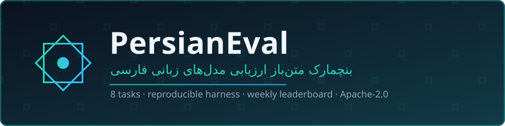

<div dir="ltr" align="center">



# PersianEval

**The first serious open-source benchmark for evaluating LLMs on Persian (Farsi).**
**اولین بنچمارک متن‌بازِ جدی برای ارزیابی مدل‌های زبانی فارسی**

[](https://github.com/Abolfazlrwm/persianeval/actions/workflows/ci.yml)
[](https://pypi.org/project/persianeval/)
[](https://pypi.org/project/persianeval/)
[](LICENSE)
[](https://github.com/Abolfazlrwm/persianeval/stargazers)
[](https://pypi.org/project/persianeval/)

[English](#english) · [فارسی](#فارسی) · [Leaderboard](https://Abolfazlrwm.github.io/persianeval/)

</div>

<div dir="ltr">

## English

### Why this project matters

Persian is spoken by more than 100 million people, yet the LLM ecosystem has almost no
*trustworthy* way to measure Persian capability. Popular leaderboards barely cover Farsi,
translated datasets are often machine-translated and leaked into training data, and the
challenges that are uniquely Persian — Arabic/Persian homoglyphs (ي/ی، ك/ک), half-space
rules (نیم‌فاصله), the cultural commons of Iran — are invisible to most benchmarks.
**PersianEval** fills that gap with 8 frozen, checksummed tasks, a reproducible async
evaluation harness, and an auditable leaderboard pipeline. Everything —
code, data, prompts, judge prompts, scores — is Apache-2.0 and open.

### Tasks (8)

| Task | What it measures | Scoring | Min samples |
|---|---|---|---|
| `reasoning` | Multi-step arithmetic & logic in Persian (GSM8K-style, nativized) | exact | 200 |
| `reading_comprehension` | Passage + short literal questions | fuzzy ≥ 0.85 | 200 |
| `spelling` | ي/ی، ك/ك confusion, Arabic digits, ZWNJ (نیم‌فاصله) | fuzzy ≥ 0.90 | 200 |
| `cultural_knowledge` | Iranian history, literature, geography (MCQ) | exact | 200 |
| `translation_fa_en` | FA↔EN translation, 4 registers | LLM judge | 200 |
| `rag_faithfulness` | Is the answer grounded in the passage? (RAG companion) | exact | 200 |
| `bias_detection` | Stereotype generalization about Iranian groups & gender | LLM judge | 200 |
| `code_with_persian_comments` | Complete Python functions from Persian specs | LLM judge | 200 |

> Every task ships exactly **200 frozen, checksummed samples** since v0.1.0 (1,600 in total) —
> see [data provenance](src/persianeval/data/README.md) for per-task counts and sources.

### Quickstart

```bash
pip install persianeval
export OPENAI_API_KEY=sk-...            # or ANTHROPIC_API_KEY / local Ollama
persianeval tasks                       # list the 8 tasks
persianeval run --task reasoning --provider openai --model gpt-4o-mini --rpm 60
persianeval leaderboard --results-dir results --out leaderboard   # static site
```

Every run is **reproducible**: fixed seed (default 42), temperature 0, responses cached per
`provider+model+task+seed+prompt` in `.persianeval_cache/`. Cost is controlled with
`--max-tokens`, `--max-requests-per-minute` and `--max-requests`.

### Sample CLI output

```text
$ persianeval run --task reasoning --provider dummy --model demo --limit 5
task=reasoning provider=dummy model=demo seed=42 temperature=0.0 concurrency=4
--------------------------------------------------------
accuracy : 0.00%   mean score: 0.000
items    : 5 (0 served from cache)
results  : results/reasoning__demo.json
results  : results/reasoning__demo.parquet
```

Results are written with an explicit pydantic schema (`RunResult`, schema version 1.0) to
both **JSON** and **Parquet**.

### Leaderboard

The leaderboard is a dependency-free static page (sortable table + radar chart) that
[`.github/workflows/leaderboard.yml`](.github/workflows/leaderboard.yml) is meant to
regenerate weekly by evaluating a rotating seeded sample of open-source models
(Qwen 2.5, Llama 3.1, Gemma 2, Aya Expanse) through local Ollama runners on GitHub-hosted
CPU runners.

**Status: pipeline shipped, no complete public run yet.** The current
[`data.json`](leaderboard/data.json) has an empty `rows` array — the weekly CPU jobs were
killed mid-run inside the runner time budget (see the sizing note in the workflow), and
the committed results so far are the frozen task sets, not model scores. The screenshot
that used to sit here was a design mock, not a real result — it has been removed until a
real run fills the table. To produce one, dispatch the workflow with a larger runner (or
a hosted judge) and let it publish; no code changes are needed.

> This section will say "updated weekly" again once the first full run lands.

### Adding a task in 15 minutes

Implement `AbstractTask`, ship a JSONL file with `{"id","prompt","expected","metadata"}`,
register nothing — the entry-point group `persianeval.tasks` picks external packages up
automatically. Full walkthrough: [`docs/adding_a_task.md`](docs/adding_a_task.md).

### Contributing

PRs welcome — data additions must carry a documented source and a permissive license;
code must pass `ruff`, `mypy --strict` and `pytest ≥ 80%` coverage (CI enforces all
three). See [`CONTRIBUTING.md`](CONTRIBUTING.md).

### License & citation

Apache-2.0 — free for research and commercial use, including data reuse. If you use
PersianEval, please cite (see [`CITATION.cff`](CITATION.cff)):

```bibtex
@software{persianeval2026,
  title  = {PersianEval: An Open-Source Benchmark for Persian LLMs},
  author = {PersianEval Contributors},
  year   = {2026},
  url    = {https://github.com/Abolfazlrwm/persianeval},
  version= {v0.1.1}
}
```

</div>

<div dir="rtl">

## فارسی

### چرا این پروژه مهم است

بیش از ۱۰۰ میلیون نفر فارسی‌زبان‌اند، اما اکوسیستم مدل‌های زبانی تقریباً هیچ راه *قابل
اعتمادی* برای سنجش توانایی فارسی ندارد. لیدربوردهای معروف فارسی را پوشش نمی‌دهند،
دیتاست‌های ترجمه‌شده اغلب با ماشین ترجمه شده‌اند و احتمالاً به داده‌های آموزشی نشت کرده‌اند،
و چالش‌های «تک‌فارسی» — هم‌گردانی عربی/فارسی (ي/ی، ك/ک)، قواعد نیم‌فاصله، دانش فرهنگی
ایران — در بیشتر بنچمارک‌ها دیده نمی‌شوند. **PersianEval** این خلأ را پر می‌کند: ۸ تسک
فریزشده و checksumدار، یک هارنس ارزیابی async و تکرارپذیر، و یک خط لولهبورد ممیزی‌پذیر. همه‌چیز — کد، داده، پرامپت، پرسش‌های داور و
نتایج — با لایسنس Apache-2.0 باز است.

### تسک‌ها (۸ تسک)

| تسک | چه چیزی را می‌سنجد | امتیازدهی | حداقل نمونه |
|---|---|---|---|
| `reasoning` | استدلال چندمرحله‌ای ریاضی و منطقی به فارسی | exact | ۲۰۰ |
| `reading_comprehension` | متن + پرسش کوتاه مستقیم | fuzzy ≥ ۰٫۸۵ | ۲۰۰ |
| `spelling` | هم‌گردانی ي/ی و ك/ک، ارقام عربی، نیم‌فاصله | fuzzy ≥ ۰٫۹۰ | ۲۰۰ |
| `cultural_knowledge` | تاریخ، ادبیات و جغرافیای ایران (چهارگزینه‌ای) | exact | ۲۰۰ |
| `translation_fa_en` | ترجمهٔ دوسویه در چهار سبک | داور LLM | ۲۰۰ |
| `rag_faithfulness` | آیا پاسخ به متن وفادار است؟ (مکمل RAG فارسی) | exact | ۲۰۰ |
| `bias_detection` | تعمیم کلیشه دربارهٔ گروه‌های ایرانی و جنسیت | داور LLM | ۲۰۰ |
| `code_with_persian_comments` | تکمیل تابع پایتون از توضیح فارسی | داور LLM | ۲۰۰ |

> هر ۸ تسک از نسخهٔ 0.1.0 دقیقاً **۲۰۰ نمونهٔ فریزشده و checksumدار** دارند (مجموعاً
> ۱۶۰۰ نمونه) — شمارش دقیق و منبع هر تسک در
> [مستند داده‌ها](src/persianeval/data/README.md) آمده است.

### شروع سریع

```bash
pip install persianeval
export OPENAI_API_KEY=sk-...            # یا ANTHROPIC_API_KEY / مدل محلی با Ollama
persianeval tasks                       # فهرست ۸ تسک
persianeval run --task reasoning --provider openai --model gpt-4o-mini --rpm 60
persianeval leaderboard --results-dir results --out leaderboard   # صفحهٔ استاتیک
```

هر اجرا **تکرارپذیر** است: seed ثابت (پیش‌فرض ۴۲)، دمای صفر، و کشِ پاسخ به‌ازای
`provider+model+task+seed+prompt` در `.persianeval_cache/`. هزینه با `--max-tokens`،
`--max-requests-per-minute` و `--max-requests` کنترل می‌شود.

### خروجی نمونهٔ CLI

```text
$ persianeval run --task reasoning --provider dummy --model demo --limit 5
task=reasoning provider=dummy model=demo seed=42 temperature=0.0 concurrency=4
--------------------------------------------------------
accuracy : 0.00%   mean score: 0.000
items    : 5 (0 served from cache)
results  : results/reasoning__demo.json
results  : results/reasoning__demo.parquet
```

نتایج با اسکیمای صریح pydantic (`RunResult`، نسخهٔ اسکیما ۱٫۰) در هر دو قالب **JSON** و
**Parquet** نوشته می‌شوند.

### لیدربورد

لیدربورد صفحه‌ای استاتیک و بدون وابستگی است (جدول قابل مرتب‌سازی + نمودار رادار) که
`.github/workflows/leaderboard.yml` قرار است هر هفته با ارزیابی نمونه‌ای چرخشی و seedدار از
مدل‌های اپن‌سورس (Qwen 2.5، Llama 3.1، Gemma 2 و Aya Expanse) روی رانرهای CPU گیت‌هاب
بازتولید کند.

**وضعیت: زیرساخت آماده است، ولی هنوز هیچ اجرای کامل منتشرشده‌ای نداریم.** `data.json` فعلی
آرایه `rows` خالی دارد — کارهای هفتگی CPU میان‌راه kill شده‌اند (بودجهٔ زمانی رانر؛ یادداشت
اندازه‌گیری داخل workflow) و نتایج کامیت‌شده تا امروز فقط مجموعه‌های تسک فریزشده‌اند، نه
امتیاز مدل. تصویری که اینجا بود ماک طراحی بود، نه نتیجهٔ واقعی — تا وقتی یک اجرای واقعی جدول
را پر کند حذف شده است. برای تولیدش، workflow را با رانر بزرگ‌تر (یا داور میزبانی‌شده) اجرا
کنید؛ تغییر کدی لازم نیست.

### اضافه‌کردن تسک جدید در ۱۵ دقیقه

کافی است `AbstractTask` را پیاده کنید و یک فایل JSONL با اسکیمای
`{"id","prompt","expected","metadata"}` اضافه کنید؛ پکیج‌های بیرونی هم به‌صورت خودکار از
طریق گروه entry-point با نام `persianeval.tasks` شناسایی می‌شوند. راهنمای کامل:
[`docs/adding_a_task.md`](docs/adding_a_task.md).

### مشارکت

PR خوش‌آمدید — افزوده‌های داده باید منبع مستند و لایسنس آزاد داشته باشند؛ کد باید
`ruff`، `mypy --strict` و پوشش تست `pytest ≥ ۸۰٪` را پاس کند (CI هر سه را اجباری می‌کند).
بیشتر بخوانید: [`CONTRIBUTING.md`](CONTRIBUTING.md).

### لایسنس و ارجاع

Apache-2.0 — آزاد برای پژوهش و استفادهٔ تجاری، شامل بازاستفادهٔ داده‌ها. اگر از PersianEval
استفاده می‌کنید، لطفاً ارجاع دهید (بخش بالا / [`CITATION.cff`](CITATION.cff)).

</div>
